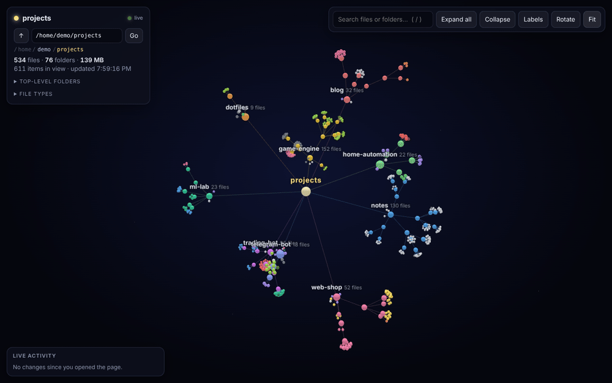
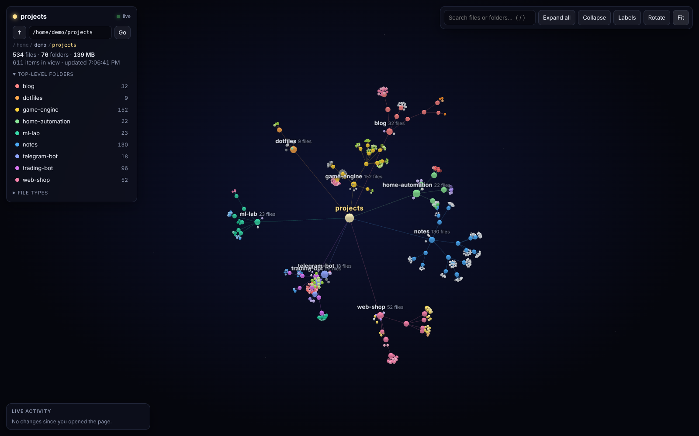
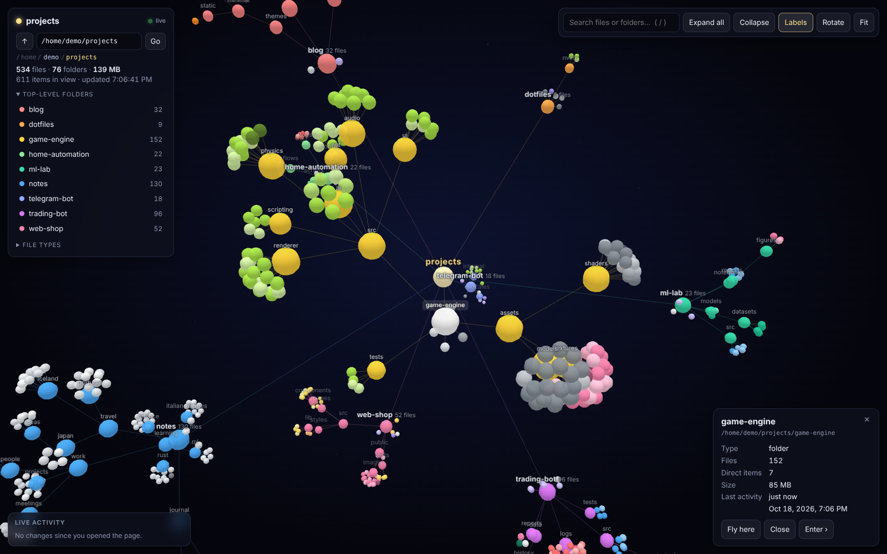
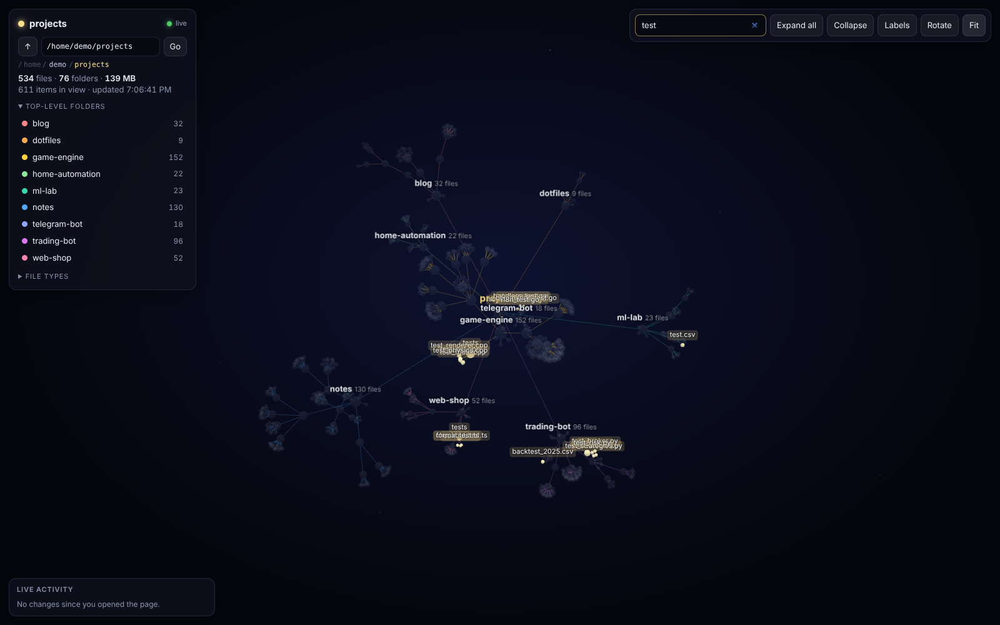
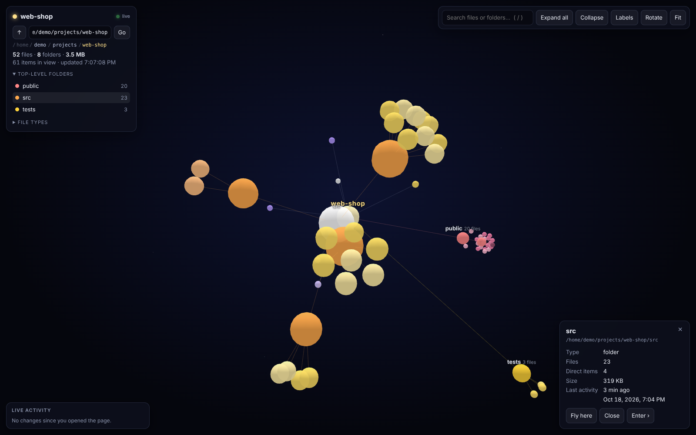
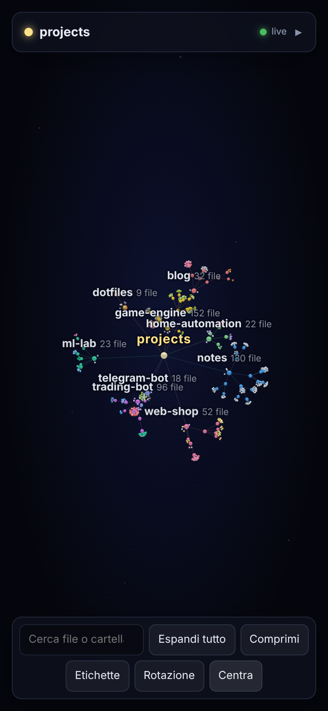
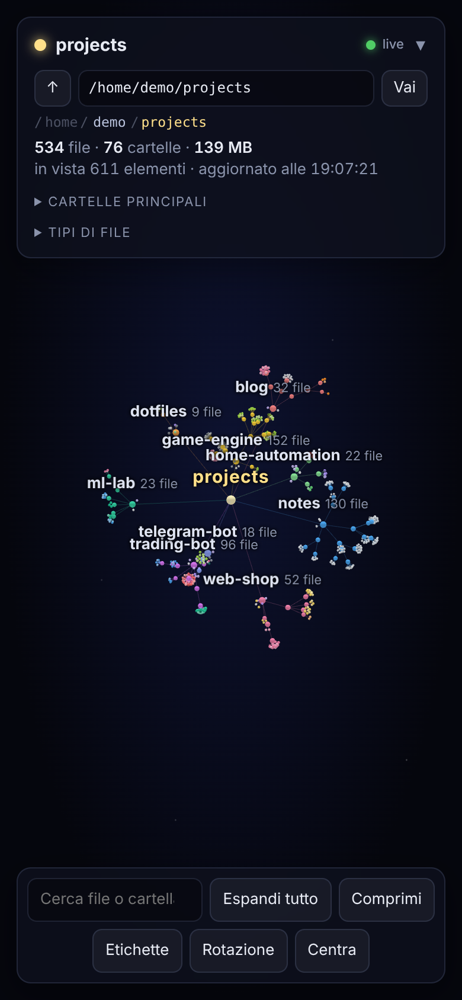

<div align="center">

# Folder Galaxy

**A live 3D constellation of your folders and files.**
Every project becomes a galaxy, every folder a branch, every file a star, and it all updates in real time while you work.

[](https://github.com/tobiagola-hue/folder-galaxy/actions/workflows/tests.yml)


[](LICENSE)

[Quick start](#quick-start) · [Install on your device](#install-on-your-device) · [Configuration](#configuration) · [FAQ](#faq--troubleshooting) · [Italiano](README.it.md)



</div>

---

## What it is

Folder Galaxy is a tiny web app that turns a folder (your projects, your home, a single repo) into an interactive 3D map you open in the browser.

It was built for a **headless home server**: the server watches the folder, and you look at it from your laptop, tablet or phone. Every change shows up in real time, with no refresh and no re-run: new files pop in, deleted ones fade out, busy folders glow.

It's **one Python file with no dependencies**, so it also runs on your Mac, Windows PC or Raspberry Pi in a few seconds.

## Features

**Live**
- **Real-time updates.** Files created, modified or deleted appear within seconds, streamed to the page with Server-Sent Events. Only the differences are sent.
- **Activity feed.** The latest creations, changes and deletions are listed in a panel; click one to fly to it.
- **Heat map.** Recently modified files glow brighter, while files untouched for months fade out.

**Visual**
- **Galaxy layout.** Each top-level folder is its own galaxy, and inside it the tree grows outward like branches, so siblings stay together.
- **Meaningful colours.** Folders take their galaxy's colour, and files are coloured by type (Python, JS/TS, web, other code, config, docs, data, logs, media).
- **Meaningful sizes.** A folder's size reflects how many files it holds, and a file's size reflects its weight.
- **Stable layout.** The same folder always produces the same constellation, so you learn where things are.

**Navigation**
- **Pick any folder** from the page: a path bar with sub-folder suggestions, ↑ to go up, clickable breadcrumbs, **Enter ›** to dive into a folder, and browser back/forward. Every view has its own URL, so you can bookmark it.
- **Search** by name (`/` to focus, `Enter` to fly to the first match).
- **Click to expand or collapse** any folder. Folders with more than 120 items start collapsed.
- **Fly-to camera**, auto-rotate, labels for every folder, and one-click "fit everything".

**Safe by design**
- **Read-only.** It only reads names, sizes and dates, never file contents, and never writes anything.
- **Sandboxed browsing.** The page can't leave the folder you allow (`BROWSE_ROOT`). Symlinks are resolved before checking and never followed while scanning.
- **Private by default.** Run directly, it only listens on `127.0.0.1`. You choose when to open it to your network.

**Runs anywhere**
- **Zero dependencies.** Python standard library only. The 3D engine is bundled, so the page works offline too.
- **Docker image** for `amd64`, `arm64` and `armv7` (PCs, Apple-silicon Macs, Raspberry Pi, NAS).
- Linux, macOS and Windows, on desktop and mobile browsers, in English and Italian (picked automatically).
- **Light.** Folders are only watched while a page is open, and huge folders are checked less often.

## Screenshots

| Overview | A galaxy up close, with labels |
|---|---|
|  |  |
| **Search highlights matches** | **Dive into a single project** |
|  |  |

<p align="center">
  
  &nbsp;&nbsp;
  
  <br><sub>On a phone: touch to rotate, pinch to zoom, and a foldable menu.</sub>
</p>

---

## Quick start

You need **Python 3.9+** (already installed on most Linux and macOS systems) or **Docker**.

**Option A: just run it**

```bash
git clone https://github.com/tobiagola-hue/folder-galaxy.git
cd folder-galaxy
python3 server.py ~/projects --open
```

Your browser opens at <http://localhost:8765>. Replace `~/projects` with any folder; without it, you get your home folder.

**Option B: Docker Compose** (best for an always-on server)

```bash
git clone https://github.com/tobiagola-hue/folder-galaxy.git
cd folder-galaxy
cp .env.example .env        # then set BROWSE_ROOT and DEFAULT_ROOT
docker compose up -d --build
```

Open `http://<server-ip>:8765`. It restarts by itself after a reboot.

**Option C: one `docker run`** with the prebuilt image

```bash
docker run -d --name folder-galaxy --restart unless-stopped -p 8765:8765 \
  -v "$HOME:$HOME:ro" -e BROWSE_ROOT="$HOME" -e DEFAULT_ROOT="$HOME/projects" -e HOME="$HOME" \
  ghcr.io/tobiagola-hue/folder-galaxy:latest
```

> No git? Download the ZIP from the green **Code** button on GitHub and unzip it. Everything else is the same.

---

## Install on your device

<details open>
<summary><b>Headless Linux server / homelab (Docker)</b>, the setup it was built for</summary>

1. Copy the project to the server, with `git clone` or by copying the folder over SSH:
   ```bash
   scp -r folder-galaxy user@server:~/
   ```
2. On the server, create the settings file:
   ```bash
   cd ~/folder-galaxy
   cp .env.example .env
   nano .env
   ```
   ```ini
   BROWSE_ROOT=/home/user            # the page can never leave this folder
   DEFAULT_ROOT=/home/user/projects  # folder shown when the page opens
   ```
3. Start it:
   ```bash
   docker compose up -d --build
   docker compose logs -f            # look for "Folder Galaxy ... start folder ..."
   ```
4. From any device on your network, open `http://<server-ip>:8765`. Find the IP with `hostname -I`.

The folder is mounted **read-only** at the same path, so the page shows real paths. Update later with `git pull && docker compose up -d --build`.
</details>

<details>
<summary><b>Linux server without Docker (systemd)</b></summary>

```bash
git clone https://github.com/tobiagola-hue/folder-galaxy.git ~/folder-galaxy
# edit YOURUSER and the paths in the service file first
sudo cp ~/folder-galaxy/contrib/folder-galaxy.service /etc/systemd/system/
sudo systemctl daemon-reload
sudo systemctl enable --now folder-galaxy
journalctl -u folder-galaxy -f
```

The service runs `server.py ... --host 0.0.0.0`, so it can be opened from other devices.
</details>

<details>
<summary><b>macOS</b></summary>

```bash
git clone https://github.com/tobiagola-hue/folder-galaxy.git
cd folder-galaxy
python3 server.py ~/Developer --open
```

- If `python3` is missing, macOS offers to install the Command Line Tools. You can also use `brew install python`.
- The first time it reads `Desktop`, `Documents` or `Downloads`, macOS may ask to allow Terminal access. That's expected.
- `~/Library` is skipped by default because it's huge and not interesting to look at.
</details>

<details>
<summary><b>Windows</b></summary>

Install Python from [python.org](https://www.python.org/downloads/) (tick *"Add python.exe to PATH"*) or from the Microsoft Store, then in PowerShell:

```powershell
git clone https://github.com/tobiagola-hue/folder-galaxy.git
cd folder-galaxy
py server.py "$env:USERPROFILE\projects" --open
```

You can type paths as `C:\Users\me\projects` or `C:/Users/me/projects`. `AppData` and the recycle bin are skipped by default.
</details>

<details>
<summary><b>Raspberry Pi</b></summary>

Raspberry Pi OS already ships Python 3:

```bash
git clone https://github.com/tobiagola-hue/folder-galaxy.git
cd folder-galaxy
python3 server.py ~/projects --host 0.0.0.0
```

Or use Docker (the image supports `arm64` and `armv7`). To start it at boot without Docker, use the systemd service above.
</details>

<details>
<summary><b>NAS (Synology, Unraid, TrueNAS, …)</b></summary>

Use **Container Manager / Docker Compose** with the included `docker-compose.yml`, or with this minimal one:

```yaml
services:
  folder-galaxy:
    image: ghcr.io/tobiagola-hue/folder-galaxy:latest
    restart: unless-stopped
    ports: ["8765:8765"]
    volumes: ["/volume1/projects:/volume1/projects:ro"]
    environment:
      BROWSE_ROOT: /volume1/projects
      DEFAULT_ROOT: /volume1/projects
```
</details>

<details>
<summary><b>Opening it from your phone or from outside home</b></summary>

- **Same Wi-Fi:** start it with `--host 0.0.0.0` (Docker already does this) and open `http://<computer-ip>:8765`.
- **From anywhere:** use a private network such as [Tailscale](https://tailscale.com/) or WireGuard and open `http://<tailscale-ip>:8765`. **Don't** expose the port directly to the internet: there is no login, by design.
- **Behind a reverse proxy:** it works with nginx out of the box (the live stream sends `X-Accel-Buffering: no`). With other proxies, disable response buffering for `/api/events`.
</details>

---

## Using the page

| Action | Mouse / keyboard | Touch |
|---|---|---|
| Rotate | drag | one-finger drag |
| Zoom | scroll wheel | pinch |
| Pan | right-drag | two-finger drag |
| Open / close a folder | click it | tap it |
| Details, Fly here, Enter › | click any node | tap any node |
| Search | `/`, then type; `Enter` flies to the first match | search box |
| Clear selection / search | `Esc` | × |
| Change folder | path bar, ↑, breadcrumbs, browser back | same |

**Reading the map**

| You see | It means |
|---|---|
| A galaxy | a top-level folder of the current view |
| Bigger folder sphere | more files inside |
| Bigger file sphere | bigger file |
| File colour | file type (see *File types* in the panel) |
| Brighter star | modified in the last 20 minutes |
| Dimmer star | untouched for more than 60 days |
| White flash | new or modified file |
| Red flash | deleted file |
| `▸ name (123)` | collapsed folder: click to open |

**How the layout works.** It's a physics simulation. Links act like springs that keep children close to their folder. A "branch" force makes each folder grow away from its parent, so siblings stay on the same side. A "galaxy" force measures the cloud of each top-level folder and pushes overlapping clouds apart, while the root stays pinned at the centre. Starting positions come from a hash of each path, so the same folder always produces the same picture.

---

## Configuration

Every setting can be passed as a command-line option or as an environment variable (Docker reads them from `.env`).

| Option | Environment variable | Default | What it does |
|---|---|---|---|
| `ROOT` (positional) | `DEFAULT_ROOT` | your home folder | Folder shown when the page opens |
| `--browse-root` | `BROWSE_ROOT` | your home folder (or `ROOT`, if it's outside home) | The page can never leave this folder |
| `--host` | `HOST` | `127.0.0.1` (`0.0.0.0` in Docker) | Address to listen on; `0.0.0.0` allows other devices |
| `--port` | `PORT` | `8765` | Port |
| `--interval` | `SCAN_INTERVAL` | `3` | Seconds between checks; big folders are slowed down automatically |
| `--max-nodes` | `MAX_NODES` | `30000` | Safety limit on items per view |
| `--exclude-extra` | `EXCLUDE_EXTRA` | – | Extra names to ignore, comma separated, wildcards allowed (`data,*.tmp`) |
| – | `EXCLUDE` | see below | Replaces the default ignore list entirely |
| `--open` | – | off | Opens the browser on start |

**Ignored by default:** `.git`, `.hg`, `.svn`, `node_modules`, `venv`, `.venv`, `__pycache__`, `*.pyc`, tool caches (`.mypy_cache`, `.pytest_cache`, `.ruff_cache`, `.tox`, `.gradle`, `.m2`, `.next`, `.nuxt`, `site-packages`), editor folders (`.idea`, `.vscode`, `.vscode-server`, `.cursor-server`), and heavy home-folder stuff (`.cache`, `.local`, `.npm`, `.nvm`, `.pyenv`, `.cargo`, `.rustup`, `.conda`, `miniconda3`, `anaconda3`, `snap`, `.docker`, `.Trash`, `Library`, `AppData`, `$RECYCLE.BIN`, `System Volume Information`, `.DS_Store`).

You can also force the language with `?lang=en` or `?lang=it` in the URL.

---

## Security & privacy

- **Read-only, metadata only.** Only file names, sizes and modification times are read. File contents are never opened.
- **Sandboxed.** Every requested path is resolved (`realpath`, so `..` and symlinks are handled) and refused if it's outside `BROWSE_ROOT`. Symlinked folders are shown but never entered.
- **Docker hardening.** The folder is mounted with `:ro`, and the container has a memory limit.
- **No login.** Anyone who can reach the port can browse the names inside `BROWSE_ROOT`. Keep it on `127.0.0.1`, your LAN or a VPN like Tailscale, and don't port-forward it to the internet.
- **No telemetry, no external requests.** The 3D engine is bundled locally.

## Performance

- A scan of ~2,000 items takes a few milliseconds; ~30,000 items take about 0.2 s on a modern CPU (still well under a second on a small mini PC).
- When a scan gets slow, the interval stretches automatically (to 5× the scan time), so big folders never hog the CPU.
- Folders are only watched while at least one page shows them, and watching stops a minute after the last page closes.
- In the browser, a few thousand visible nodes run smoothly on laptops and recent phones. Use **Collapse**, `EXCLUDE_EXTRA` or `MAX_NODES` for giant trees.

## API

Handy if you want to build on top of it. All endpoints are `GET`:

| Endpoint | Returns |
|---|---|
| `/api/check?root=PATH` | `{ok, path, error, base, default, version}`. Validates a folder (`error`: `outside`, `missing`, `denied`) |
| `/api/dirs?path=PATH` | Sub-folders of a folder (used for suggestions) |
| `/api/tree?root=PATH` | A full JSON snapshot of the folder |
| `/api/events?root=PATH` | A Server-Sent Events stream: one `snapshot`, then `diff` events with `added`, `removed`, `changed` |
| `/health` | `ok` |

Each node is `{id, p, n, t, s, m, f, e}`: the relative path, parent id, name, type (`d`/`f`), size in bytes, mtime, file count (folders), and unreadable flag.

## Development

```
folder-galaxy/
├── server.py                 # the whole backend (stdlib only)
├── static/
│   ├── index.html            # the whole frontend (HTML + CSS + JS)
│   └── 3d-force-graph.min.js # bundled 3D engine
├── tests/test_server.py      # unit + HTTP tests
├── Dockerfile, docker-compose.yml, .env.example
├── contrib/folder-galaxy.service
└── .github/workflows/        # tests on Linux/macOS/Windows, multi-arch Docker image
```

```bash
python3 -m unittest discover -s tests -v      # run the tests
python3 server.py . --interval 1 --open       # hack on it while watching itself
```

Issues and pull requests are welcome. Some ideas: themes, a "time-lapse" of the last hour, git status colours, size/age filters, or showing the folder disk usage as rings.

---

## FAQ & troubleshooting

<details>
<summary><b>Why aren't two folders of the same project next to each other?</b></summary>
They are. Each folder grows outward from its parent, so siblings stay on the same side. In 3D, two galaxies can look overlapped just because one is behind the other: rotate the view a little.
</details>

<details>
<summary><b>The page says "Only folders inside … can be shown".</b></summary>
That's the sandbox. Start the server with a wider <code>--browse-root</code> (or <code>BROWSE_ROOT</code>), and with Docker remember to mount that folder too (<code>docker-compose.yml</code> does it automatically from <code>.env</code>).
</details>

<details>
<summary><b>I can't open it from my phone.</b></summary>
Run with <code>--host 0.0.0.0</code> (Docker already does this), use the computer's IP rather than <code>localhost</code>, and check the firewall (<code>sudo ufw allow 8765/tcp</code> on Ubuntu; on Windows, allow Python when asked).
</details>

<details>
<summary><b>"cannot listen on …:8765"</b></summary>
Something else uses the port. Start with <code>--port 8790</code>, or set <code>PORT=8790</code> in <code>.env</code>.
</details>

<details>
<summary><b>The dot is red and says "reconnecting…"</b></summary>
The server stopped or the machine can't be reached. The page reconnects automatically as soon as it's back.
</details>

<details>
<summary><b>A folder shows "More than 30,000 items".</b></summary>
Raise <code>MAX_NODES</code>, or better, exclude the noisy part (<code>EXCLUDE_EXTRA=data,backups</code>) or open a sub-folder.
</details>

<details>
<summary><b>Does it work with network drives?</b></summary>
Yes, as long as the folder is mounted and readable. Network drives are slower to scan, and the interval adapts automatically.
</details>

---

## Credits

- 3D rendering by [3d-force-graph](https://github.com/vasturiano/3d-force-graph) (MIT) by Vasco Asturiano, built on [three.js](https://threejs.org/) and [d3-force-3d](https://github.com/vasturiano/d3-force-3d). See [THIRD_PARTY_NOTICES.md](THIRD_PARTY_NOTICES.md).
- Built with a lot of help from [Claude](https://claude.ai).

## License

[MIT](LICENSE). Do what you like, a star is always appreciated.
